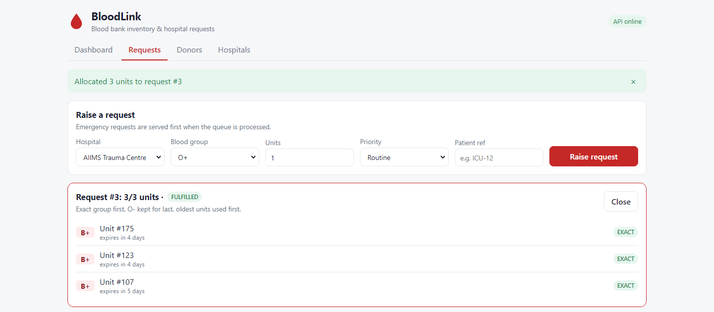
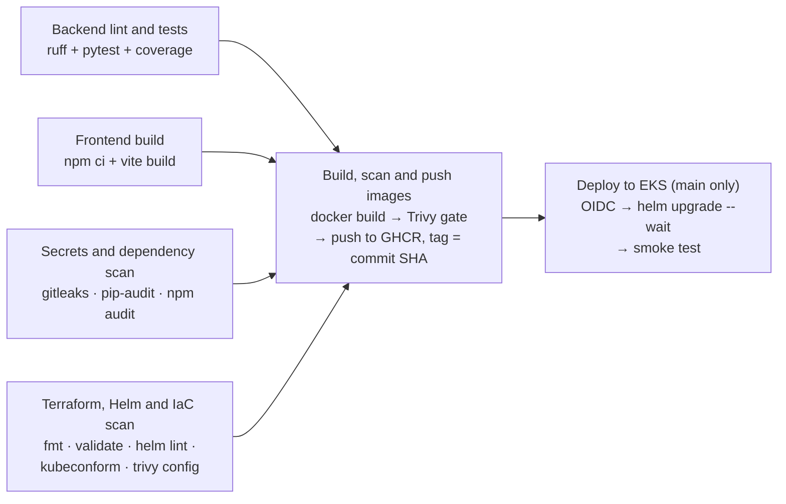
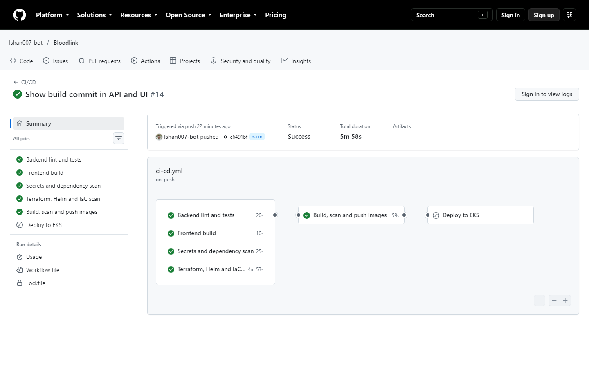
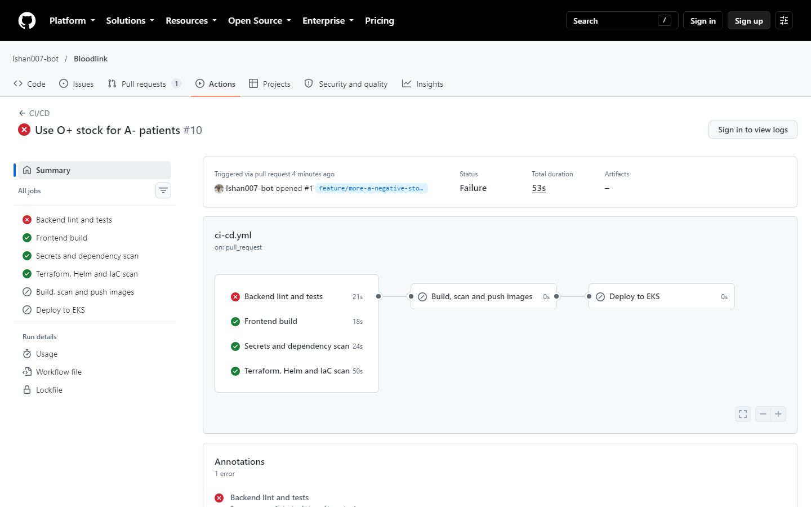
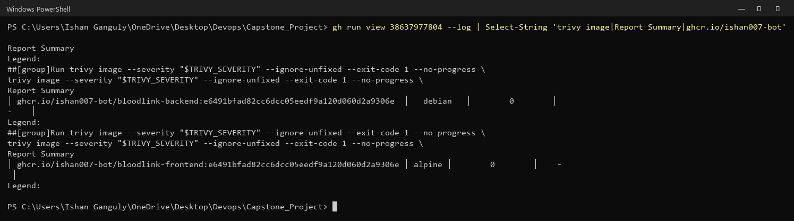
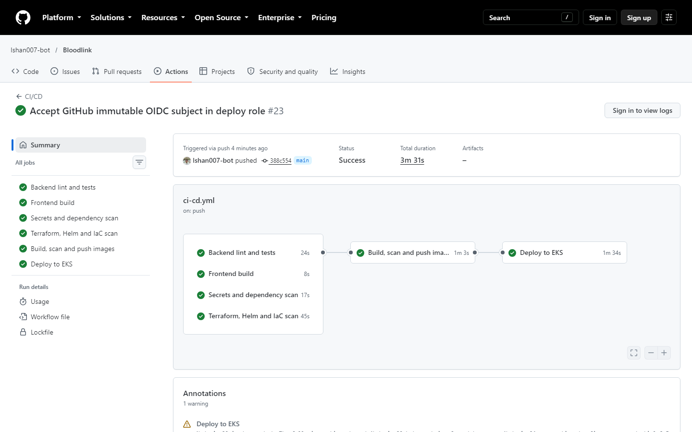
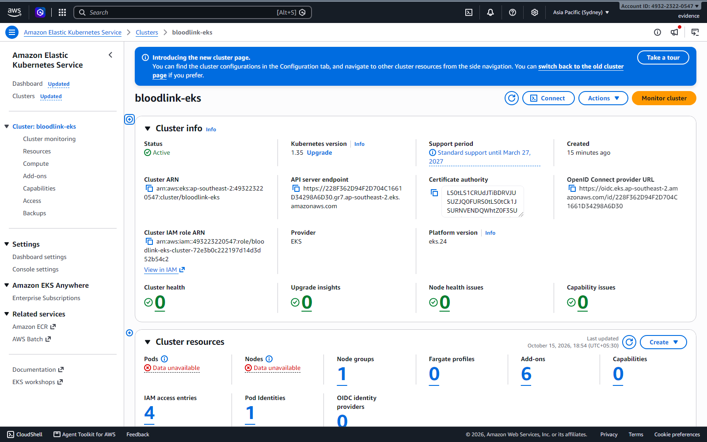
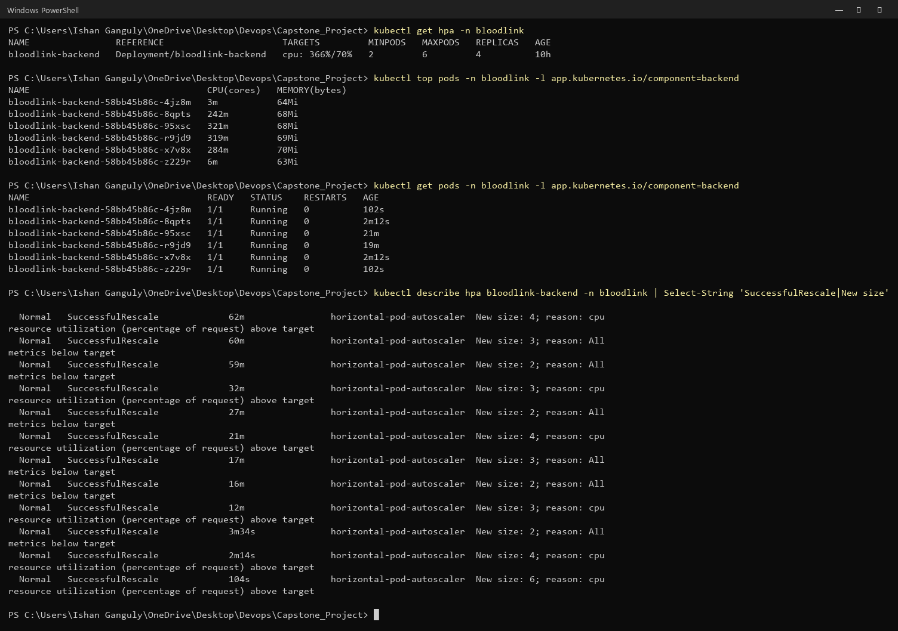

# BloodLink

**Blood bank inventory and hospital request system.** Donors give blood, every unit is tracked
until it is used or expires, and hospitals request units for patients. BloodLink allocates
**compatible** blood, uses the **oldest units first** so less blood is wasted, serves
**emergencies first**, and warns before stock of any blood group runs out.

[](https://github.com/Ishan007-bot/Bloodlink/actions/workflows/ci-cd.yml)

**Start here:**

- **[Demo video](docs/demo/bloodlink-demo.mp4)** (3½ minutes, narrated): a real live demo. A commit is pushed,
  the project is walked through while the pipeline runs (tests, Docker, CI/CD, Trivy, AWS, Kubernetes,
  monitoring), then Helm deploys that commit and the app shows the change. The terminals replay real
  commands with their real output.
- **[Presentation slides (PDF)](docs/BloodLink-presentation.pdf)**, 10 slides, viewable right
  here on GitHub. Also as [PowerPoint](docs/BloodLink-presentation.pptx) with speaker notes.
- **[Evidence for every rubric module](docs/EVIDENCE.md)**, with about 100 screenshots.


---

## What it does

1. **A donor is registered** with a blood group. They may give whole blood again only
   **90 days** after their last donation; an earlier donation is refused with `409 Conflict`.
2. **Each donation becomes one blood unit** that **expires 42 days** after collection.
   Expired units are never issued.
3. **A hospital raises a request**: blood group, 1–20 units, routine or emergency.
4. **BloodLink allocates compatible units** (rules below). A request can be filled partly now
   and the rest later; **Process queue** fills every open request, emergencies first.
5. **The dashboard and Prometheus show stock per group**: OK, LOW (below the safety stock of 10)
   or CRITICAL (below 5), units expiring within 7 days, fill rate, wastage and emergency fill time.

### The allocation rules (`backend/app/allocation.py`)

```python
usable = [c for c in candidates if c.blood_group in preference and c.expires_at > now]
usable.sort(key=lambda c: (preference[c.blood_group], c.expires_at, c.unit_id))
```

| Rule | Why |
| :--- | :--- |
| Only ABO/Rh-compatible groups, never an expired unit | A wrong group can kill the patient |
| Exact group first, then compatible substitutes | Keeps scarce groups for the patients who need them |
| **O- (universal donor) always last** | O- patients can receive nothing else |
| Within a group, the unit closest to expiry first (FEFO) | Blood used before it expires is blood not thrown away |
| Emergencies before routine, then oldest request first | When stock is short, the sickest patient is served first |

The function is pure and takes `now` as a parameter, so the rules are unit-tested without a
database or a mocked clock.

| Recipient | Can receive (in allocation order) |
| :--- | :--- |
| O- | O- |
| O+ | O+, O- |
| A- | A-, O- |
| A+ | A+, A-, O+, O- |
| B- | B-, O- |
| B+ | B+, B-, O+, O- |
| AB- | AB-, A-, B-, O- |
| AB+ | AB+, AB-, A+, A-, B+, B-, O+, O- |

A filled request lists each unit it received, its expiry and whether it was an exact match:



---

## Architecture


| Layer | Technology | Notes |
| :--- | :--- | :--- |
| Frontend | React 19 + Vite, unprivileged Nginx | `/api` upstream templated at start-up |
| Backend | Python 3.12, FastAPI, SQLAlchemy 2, Alembic, Pydantic v2 | REST API with Swagger UI, business metrics for Prometheus |
| Database | PostgreSQL 16 | StatefulSet with a PersistentVolume, nightly `pg_dump` |
| Tests | pytest, ruff | 81 tests, 97 % coverage |
| Packaging | Docker multi-stage on Alpine, Helm chart | Non-root, read-only root filesystem, no pip at runtime |
| Delivery | GitHub Actions → GHCR → Helm | Trivy gate before push, images tagged with the commit SHA |
| Cloud | Terraform → AWS VPC + EKS 1.35 | S3 remote state, OIDC deploy role, no AWS keys in GitHub |
| Observability | kube-prometheus-stack | ServiceMonitor, 7 alert rules, provisioned Grafana dashboard |

---

## CI/CD

[`.github/workflows/ci-cd.yml`](.github/workflows/ci-cd.yml) runs on every push to `main` and
on every pull request:





- **Tests gate everything.** No image is built if a test or a scan fails.
- **Images are scanned before they are pushed.** Trivy fails the job on any HIGH or CRITICAL
  finding, fixable or not, so a vulnerable image never reaches GHCR or a cluster.
- **Tags are commit SHAs, never `latest`**, so every running pod traces back to a commit. The
  commit is also baked into the image and shown in the app's footer (`Build 6d91154`).
- **Deploys use short-lived credentials.** The deploy job assumes an AWS role through GitHub
  OIDC; no AWS key is stored in GitHub.

### The pipeline stopping a dangerous change

[Pull request #1](https://github.com/Ishan007-bot/Bloodlink/pull/1), "Use O+ stock for A-
patients", looks helpful (A- stock is often low) but would give Rh-positive blood to
Rh-negative patients. `test_compatibility_pairs[O+-A--False]` failed, so **no image was built
and nothing was deployed**. The fix was pushed to the same PR, every job passed, and it was merged.



---

## Security

| Control | Where |
| :--- | :--- |
| Trivy gate on both images, failing on any HIGH or CRITICAL, before the push | CI `images` job |
| Trivy misconfiguration scan of Terraform, Helm and Dockerfiles; exceptions listed with reasons | CI `iac` job, [`.trivyignore`](.trivyignore) |
| gitleaks scan of the whole Git history | CI `source-security` job |
| pip-audit and npm audit on every dependency | CI `source-security` job |
| Alpine base images, no pip or setuptools in the runtime image | [`backend/Dockerfile`](backend/Dockerfile), [`frontend/Dockerfile`](frontend/Dockerfile) |
| Every container non-root, all capabilities dropped, seccomp, read-only root filesystem | Helm templates |
| Namespace enforces the Pod Security `restricted` profile | [`k8s/namespace.yaml`](k8s/namespace.yaml) |
| NetworkPolicy: only the backend can reach PostgreSQL | [`helm/bloodlink/templates/networkpolicy.yaml`](helm/bloodlink/templates/networkpolicy.yaml) |
| Database credentials in a Kubernetes Secret, never in Git | Helm chart |
| GitHub deploys to AWS through OIDC, trusted only for this repo's `production` environment | [`terraform/github-oidc.tf`](terraform/github-oidc.tf) |
| EKS secrets encrypted with a KMS key; EBS volumes encrypted | `terraform/`, `k8s/storageclass-gp3.yaml` |

**The Trivy gate in practice.** At first the gate used `--ignore-unfixed`, and the backend,
then on Debian `python:3.12-slim`, passed. Scanning it without the flag showed **44 HIGH
findings from 8 CVEs with no fix yet**, in util-linux, ncurses, systemd and perl: packages
BloodLink never runs. One of them, CVE-2026-76642 in util-linux, is a local privilege
escalation through `mount`'s post-mount hooks. Moving the backend to Alpine removed them all
and shrank the image from 291 MB to 195 MB, so the gate now fails on every HIGH or CRITICAL
finding, not only fixable ones. Full write-up: [EVIDENCE.md, M6](docs/EVIDENCE.md#m6-devsecops).



---

## AWS: Terraform and EKS

[`terraform/`](terraform/) builds the whole AWS side in `ap-southeast-2` (66 resources):

| Resource | Details |
| :--- | :--- |
| VPC `10.40.0.0/16` | 2 public + 2 private subnets over two AZs, Internet Gateway, one NAT gateway |
| EKS 1.35 | Managed node group (2 × t3.medium) in the private subnets, secrets encrypted with KMS |
| Add-ons | VPC CNI with NetworkPolicy enforcement, CoreDNS, kube-proxy, Pod Identity, EBS CSI driver, metrics-server |
| GitHub OIDC | Deploy role trusted only by this repository's `production` environment |
| Remote state | S3 bucket with versioning, encryption and native lock file ([`terraform/bootstrap/`](terraform/bootstrap/)) |

[`scripts/eks-up.ps1`](scripts/eks-up.ps1) then installs ingress-nginx behind an AWS Network
Load Balancer, kube-prometheus-stack and BloodLink. After that, **every green push to `main`
deployed itself to EKS** with no manual step:





The cluster was destroyed after the evidence was taken, to stop billing (66 destroyed, then the
state bucket; [proof that nothing is left](docs/evidence/07-terraform/14-nothing-left.png)).
It can be re-applied at any time: [docs/DEPLOYMENT.md](docs/DEPLOYMENT.md).

---

## Kubernetes and Helm

One chart, [`helm/bloodlink/`](helm/bloodlink/), deploys to both kind (laptop) and EKS; only the
values file changes ([`values-kind.yaml`](helm/bloodlink/values-kind.yaml),
[`values-eks.yaml`](helm/bloodlink/values-eks.yaml)).

| Object | What it does |
| :--- | :--- |
| Deployments | Frontend (2 replicas) and backend, rolling updates with `maxUnavailable: 0` |
| Init container | Runs Alembic migrations before the backend starts, under a PostgreSQL advisory lock |
| StatefulSet + PVC | PostgreSQL with persistent storage (encrypted gp3 on EKS) |
| HPA | Backend 2–6 replicas on CPU (2–8 on EKS) |
| PodDisruptionBudget | Keeps one backend up during node drains |
| Probes | `/health` for liveness, `/ready` (checks the database) for readiness |
| CronJob | Nightly `pg_dump`, newest 7 kept |
| `helm test` | Calls the API through its Service after every install |

Under a load test the HPA scaled the backend from 2 to 6 pods, then back down:



---

## Observability

The backend exposes HTTP metrics and business metrics (`/metrics`): units available per group,
units expiring, open emergency requests, wastage and fulfilment time. A ServiceMonitor gets them
into Prometheus, and the Grafana dashboard "BloodLink - Blood Bank Overview" is provisioned from
the chart, so it exists as soon as the chart is installed.


| Alert | Fires when |
| :--- | :--- |
| `BloodLinkBackendDown` | No backend pod has been scraped for 2 minutes |
| `BloodLinkHighErrorRate` | More than 5 % of requests return 5xx for 5 minutes |
| `BloodLinkSlowAPI` | p95 latency stays above 1 s for 10 minutes |
| `BloodLinkCriticalStock` | A blood group stays below half the safety stock (5 units) |
| `BloodLinkUniversalDonorLow` | O- falls below 3 units |
| `BloodLinkEmergencyBacklog` | An emergency request has been open for 15 minutes |
| `BloodLinkUnitsExpiringSoon` | More than 20 units expire within 7 days |

---

## Running it

### Docker Compose (quickest)

```powershell
docker compose up --build                  # http://localhost:3000
docker compose --profile demo up --build   # same, plus realistic demo data
```

Compose starts PostgreSQL, waits for it to be healthy, runs the migrations once, starts the
backend once migrations succeed, then the frontend once the backend is healthy.
API docs: http://localhost:8000/docs. Stop with `docker compose down` (add `-v` to delete the data).

### Tests and lint

```powershell
cd backend
python -m venv .venv
.\.venv\Scripts\python -m pip install -r requirements-dev.txt
.\.venv\Scripts\ruff check . ; .\.venv\Scripts\ruff format --check .
.\.venv\Scripts\pytest -v --cov=app
```

81 tests across the allocation rules, the compatibility table, the API and the migrations. They
use a throwaway SQLite database configured in `tests/conftest.py`, never PostgreSQL.

### Kubernetes on your laptop (kind)

```powershell
./scripts/kind-up.ps1 -Tag (git rev-parse HEAD)   # cluster, ingress, metrics-server, Prometheus/Grafana, BloodLink
```

Then open http://bloodlink.localhost.

### AWS (Terraform + EKS)

```powershell
terraform -chdir=terraform/bootstrap init; terraform -chdir=terraform/bootstrap apply   # state bucket
terraform -chdir=terraform init -backend-config=backend.hcl
terraform -chdir=terraform plan -out=tfplan; terraform -chdir=terraform apply tfplan
./scripts/eks-up.ps1 -Tag (git rev-parse HEAD)
terraform -chdir=terraform destroy      # when finished: EKS and NAT are billed per hour
```

Step-by-step, including continuous deployment and tear-down: [docs/DEPLOYMENT.md](docs/DEPLOYMENT.md).

---

## API

Swagger UI at `/docs`.

| Method | Route | Purpose |
| :--- | :--- | :--- |
| GET | `/health` | Liveness (does not touch the database) |
| GET | `/ready` | Readiness (checks the database) |
| GET | `/metrics` | Prometheus metrics |
| GET, POST | `/api/donors` | List (filter by group / eligibility), register |
| GET, PUT, DELETE | `/api/donors/{id}` | Read, update, remove a donor |
| POST | `/api/donations` | Record a donation → new unit (90-day rule) |
| GET | `/api/units` | Units, filter by status / group |
| GET, POST | `/api/hospitals` | List, add |
| GET, PUT, DELETE | `/api/hospitals/{id}` | Read, update, remove |
| GET, POST | `/api/requests` | List (filter by status / priority), raise a request |
| GET, PUT, DELETE | `/api/requests/{id}` | Read, change or cancel, delete |
| POST | `/api/requests/{id}/fulfil` | Allocate compatible units |
| POST | `/api/requests/process-queue` | Fill all open requests, emergencies first |
| GET | `/api/inventory` | Stock and expiring units per blood group |
| GET | `/api/stats` | Fill rate, wastage, emergency fill time |
| GET | `/api/compatibility` | The compatibility table |

```powershell
# Raise an emergency request for 2 units of B+, then fill it
$r = Invoke-RestMethod -Method Post localhost:8000/api/requests -ContentType application/json `
  -Body '{"hospital_id":1,"blood_group":"B+","units_needed":2,"priority":"EMERGENCY"}'
Invoke-RestMethod -Method Post "localhost:8000/api/requests/$($r.id)/fulfil"
```

---

## Troubleshooting

[docs/RUNBOOK.md](docs/RUNBOOK.md) covers six failures, each reproduced on the cluster from
[`troubleshooting/`](troubleshooting/) with a screenshot of the symptom and the fix: image pull
failure, a Service with no endpoints, a database outage, a wrong password in the Secret, an
OOM-killed container, and a bad release rolled back with Helm. It also covers backup and restore.

It also records three **real incidents** met while building the project, with how each was
diagnosed:

| Incident | Cause | Fix |
| :--- | :--- | :--- |
| Grafana restarting | `OOMKilled` at its 256 MiB limit | Limit raised to 512 MiB |
| Scheduler and controller-manager in `CrashLoopBackOff` | Slow etcd fsync on a nearly full disk made them lose their leader leases | etcd `unsafe-no-fsync` and longer leases on the throwaway kind cluster |
| Docker Desktop would not start | Disk full from build cache and leftover Terraform providers | Pruned the cache, restarted Docker; data survived on the PersistentVolumes |

---

## Repository layout

```text
backend/            FastAPI app (app/), Alembic migrations, tests/, Dockerfile
frontend/           React app (src/), Nginx config template, Dockerfile
docker-compose.yml  postgres -> migrate -> backend -> frontend (+ optional seed)
.github/workflows/  CI/CD pipeline
terraform/          AWS VPC + EKS (+ bootstrap/ for the S3 state bucket)
helm/bloodlink/     Helm chart (+ Grafana dashboard JSON, values per environment)
k8s/                Namespace with Pod Security labels, kind cluster config, gp3 StorageClass
monitoring/         kube-prometheus-stack values
troubleshooting/    Deliberately broken manifests for the troubleshooting lab
scripts/            kind-up.ps1 / eks-up.ps1 platform setup
docs/               EVIDENCE.md (screenshots by rubric module), RUNBOOK.md, DEPLOYMENT.md, slides, demo
```

---

## Known limitations

- The API has no login. It assumes it sits behind a hospital's internal network or an SSO proxy.
- One region and one NAT gateway on AWS, to keep the cost down; production would use one NAT
  gateway per availability zone.
- The EKS cluster was created for the evidence and then destroyed to stop billing. The Terraform
  can be re-applied at any time.
