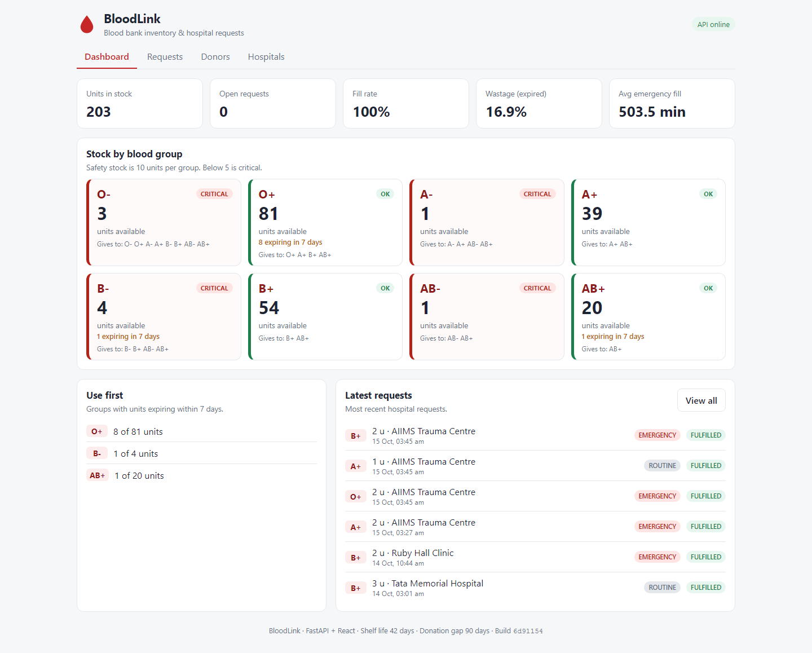
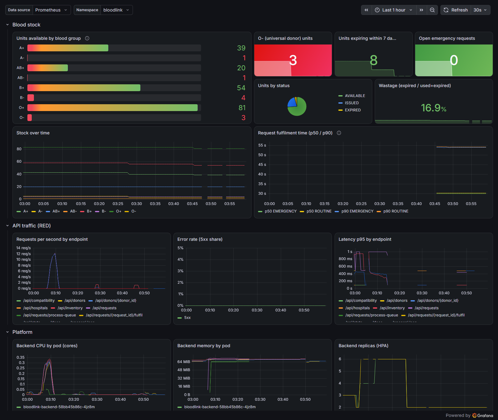

# BloodLink: evidence

Screenshots for every module of the grading rubric, in rubric order. Every screenshot was taken
from the real system: the application on a local Kubernetes cluster (kind) and Docker Compose,
on AWS EKS (built with Terraform in `ap-southeast-2`, Sydney), the GitHub Actions pipeline of
this repository, and GHCR.

- Repository: https://github.com/Ishan007-bot/Bloodlink
- Pipeline: https://github.com/Ishan007-bot/Bloodlink/actions
- Images: `ghcr.io/ishan007-bot/bloodlink-backend` and `ghcr.io/ishan007-bot/bloodlink-frontend`, tagged with the commit SHA

| Module | Section |
| :--- | :--- |
| M1 Application | [Application](#m1-application) |
| M2 Testing | [Testing](#m2-testing) |
| M3 Git and GitHub | [Git](#m3-git-and-github) |
| M4 Docker | [Docker](#m4-docker) |
| M5 CI/CD | [CI/CD](#m5-cicd) |
| M6 DevSecOps | [Security](#m6-devsecops) |
| M7 Terraform | [Terraform](#m7-terraform) |
| M8 Kubernetes + Helm | [Kubernetes](#m8-kubernetes--helm) |
| M9 Observability | [Observability](#m9-observability) |
| M8 on AWS | [BloodLink on EKS](#bloodlink-on-aws-eks) |
| M10 Live demo | [Commit to deployment](#m10-live-demo-commit--pipeline--deployment) |
| Troubleshooting | [Troubleshooting lab](#troubleshooting-lab) |

---

## M1 Application

FastAPI backend, React frontend, PostgreSQL 16 with Alembic migrations.

| Criterion | Evidence |
| :--- | :--- |
| Backend responds to `/health` | [08-api-crud](evidence/01-application/08-api-crud.png), [03-non-root-read-only](evidence/04-docker/03-non-root-read-only.png) |
| GET, POST, PUT, DELETE endpoints | [08-api-crud](evidence/01-application/08-api-crud.png): a donor is created, read, updated and deleted (204). Full list in [Swagger](evidence/01-application/07-swagger.png) |
| PostgreSQL tables managed by Alembic | [09-database-tables](evidence/01-application/09-database-tables.png): 5 tables plus `alembic_version` = `0001_initial_schema` |
| Frontend renders and calls the API | [01-dashboard](evidence/01-application/01-dashboard.png), [02-requests](evidence/01-application/02-requests.png), [04-donors](evidence/01-application/04-donors.png), [05-hospitals](evidence/01-application/05-hospitals.png) |
| Responsive, usable UI | [06-mobile](evidence/01-application/06-mobile.png) (390 px wide phone) |

The core rule of the domain, compatible allocation that uses the units closest to expiry first:
[03-fulfil-result](evidence/01-application/03-fulfil-result.png). A B+ request is filled with
three B+ units that expire in 4, 4 and 5 days, so blood that would soon be wasted is used first.



## M2 Testing

| Criterion | Evidence |
| :--- | :--- |
| `pytest` runs without errors | [01-pytest-verbose](evidence/02-testing/01-pytest-verbose.png): **81 passed** |
| At least 5 tests over 3 or more endpoints | 81 tests over every endpoint group: compatibility rules, allocation, donors, donations, hospitals, requests, fulfilment, queue, inventory, stats, health, metrics, migrations |
| Test database, not production | `tests/conftest.py` sets `DATABASE_URL=sqlite:///./test.db` before the app is imported ([02-coverage-and-lint](evidence/02-testing/02-coverage-and-lint.png)) |
| `pytest.ini` / `conftest.py` | Both present, shown in [02-coverage-and-lint](evidence/02-testing/02-coverage-and-lint.png) |

Also: **97 % line coverage**, `ruff check` and `ruff format --check` clean. CI fails if coverage
drops below 90 %.

## M3 Git and GitHub

| Criterion | Evidence |
| :--- | :--- |
| Public repository | [03-github-repo](evidence/03-git/03-github-repo.png) |
| Meaningful commit messages, 10+ commits | [01-commit-history](evidence/03-git/01-commit-history.png), [04-github-commits](evidence/03-git/04-github-commits.png) |
| `.gitignore` excludes `.env`, `__pycache__`, `node_modules`, `.venv` | [02-gitignore](evidence/03-git/02-gitignore.png): `git check-ignore` confirms each path is ignored, plus Terraform state and `*.tfvars` |

Changes go through pull requests, and a pull request with a failing test cannot ship: see
[M5](#a-broken-change-is-stopped-by-the-pipeline).

## M4 Docker

| Criterion | Evidence |
| :--- | :--- |
| `backend/Dockerfile` builds | [01-compose-up-build](evidence/04-docker/01-compose-up-build.png): `bloodlink-backend:local Built` |
| Frontend multi-stage (Node build, Nginx runtime) | [03-non-root-read-only](evidence/04-docker/03-non-root-read-only.png): `FROM node:22-alpine AS build` then `FROM nginxinc/nginx-unprivileged` |
| Images run as non-root | [03-non-root-read-only](evidence/04-docker/03-non-root-read-only.png): backend `uid=10001(app)`, frontend `uid=101(nginx)`, both with a read-only root filesystem |
| `docker compose up --build` starts all services | [01-compose-up-build](evidence/04-docker/01-compose-up-build.png), [02-compose-ps](evidence/04-docker/02-compose-ps.png): postgres healthy, migrations exit 0, backend healthy, frontend started |
| Browser at `http://localhost:3000` | [04-browser-localhost-3000](evidence/04-docker/04-browser-localhost-3000.png) |

Start-up order is enforced with health checks: PostgreSQL healthy → `migrate` (Alembic) completes →
backend healthy → frontend. Migrations run once, not in every replica.

## M5 CI/CD

Workflow: [.github/workflows/ci-cd.yml](../.github/workflows/ci-cd.yml).

```text
push / pull request
  ├─ Backend lint and tests (ruff, pytest, coverage ≥ 90 %)
  ├─ Frontend build (npm ci, vite build)
  ├─ Secrets and dependency scan (gitleaks, pip-audit, npm audit)
  └─ Terraform, Helm and IaC scan (fmt, validate, helm lint, kubeconform, trivy config)
        └─ Build, scan and push images (docker build → Trivy gate → push to GHCR, tag = commit SHA)
              └─ Deploy to EKS (OIDC, helm upgrade --set image.tag=<sha>), main only
```

| Criterion | Evidence |
| :--- | :--- |
| Workflow file present | [03-workflow-triggers](evidence/05-cicd/03-workflow-triggers.png) |
| Triggers on push to `main` | [03-workflow-triggers](evidence/05-cicd/03-workflow-triggers.png), [01-actions-runs](evidence/05-cicd/01-actions-runs.png) |
| pytest in the pipeline fails the build | [The pull request below](#a-broken-change-is-stopped-by-the-pipeline) |
| Frontend built in the pipeline | [02-main-run-green](evidence/05-cicd/02-main-run-green.png) (job "Frontend build") |
| Images built for frontend and backend | [04-images-pushed](evidence/05-cicd/04-images-pushed.png) |
| Pushed to GHCR | [05-ghcr-backend](evidence/05-cicd/05-ghcr-backend.png), [11-ghcr-frontend](evidence/05-cicd/11-ghcr-frontend.png), [12-ghcr-packages](evidence/05-cicd/12-ghcr-packages.png) |
| Tags are the commit SHA, never `latest` | [04-images-pushed](evidence/05-cicd/04-images-pushed.png): the digest the pipeline pushed equals the digest GHCR serves for tag `e6491bf…` |

Green pipeline run: https://github.com/Ishan007-bot/Bloodlink/actions/runs/38637977804

### A broken change is stopped by the pipeline

[Pull request #1](https://github.com/Ishan007-bot/Bloodlink/pull/1) "Use O+ stock for A- patients"
looks helpful (A- stock is often low) but would give Rh-positive blood to Rh-negative patients.

1. [06-pr-tests-failing](evidence/05-cicd/06-pr-tests-failing.png): the PR is marked failing.
2. [07-pr-failing-log](evidence/05-cicd/07-pr-failing-log.png): `test_compatibility_pairs[O+-A--False]` fails: `is_compatible('O+', 'A-')` returned True.
3. [08-pr-run-blocked](evidence/05-cicd/08-pr-run-blocked.png): because tests failed, **no image was built and nothing was deployed**.
4. [09-pr-fixed-green](evidence/05-cicd/09-pr-fixed-green.png): the fix is pushed and every job passes.
5. [10-pr-merge](evidence/05-cicd/10-pr-merge.png): merged.

## M6 DevSecOps

| Criterion | Evidence |
| :--- | :--- |
| Trivy scans both images in CI | [01-trivy-ci-scan](evidence/06-security/01-trivy-ci-scan.png) |
| Fails on HIGH or CRITICAL | [02-trivy-gate-config](evidence/06-security/02-trivy-gate-config.png): `TRIVY_SEVERITY: HIGH,CRITICAL`, `trivy image --severity "$TRIVY_SEVERITY" --exit-code 1`, before the push step. It fails on **any** HIGH or CRITICAL, whether or not a fix exists |
| The gate catching real CVEs | [04-strict-gate-debian-image](evidence/06-security/04-strict-gate-debian-image.png): the previous Debian-based backend image fails the strict gate with 44 HIGH findings |
| No secrets in Git | [03-secret-and-dependency-scan](evidence/06-security/03-secret-and-dependency-scan.png): gitleaks scanned all commits, `no leaks found` |

**What Trivy scans.** Each image the pipeline builds, before it is pushed: the operating-system
packages (Alpine in both images) and every Python package in the backend's virtualenv. A finding
stops the job before `docker push`, so a vulnerable image never reaches GHCR or a cluster. Trivy
also scans the Terraform and Kubernetes manifests (`trivy config`); the accepted exceptions are
listed with reasons in [.trivyignore](../.trivyignore).

**What it found, and one CVE explained.** At first the gate used `--ignore-unfixed`: it only failed
on vulnerabilities that already had a fix, and the backend, then built on Debian `python:3.12-slim`,
passed. Scanning that image without the flag showed what was being let through: **44 HIGH findings
from 8 CVEs, none with a fix available yet**, in util-linux, ncurses, systemd, acl and perl.
For example, **CVE-2026-76642** in util-linux: `mount` does not check whether an external mount
helper failed before running the privileged `X-mount.owner` / `X-mount.idmap` post-mount hooks, so
an unprivileged local user can change ownership of, or clone with suid bits, a filesystem they
should not control. That is local privilege escalation. In BloodLink the practical risk was low
(the container runs as uid 10001, with a read-only root filesystem, all capabilities dropped, and
never calls `mount`), but the vulnerable code still shipped in every image.

**The fix, and what the clean result means.** Instead of accepting the risk, the backend moved to
`python:3.12-alpine`, which does not contain those packages at all (291 MB → 195 MB); `apk upgrade`
picks up Alpine fixes published after the base image, and pip with its bundled wheels is removed,
because Trivy also scans the packages pip vendors inside itself. Both images then scanned clean at
every HIGH and CRITICAL finding, fixed or not, so `--ignore-unfixed` was removed: **0 HIGH, 0
CRITICAL** now means there is no known serious vulnerability in the image at all, not just none
with a patch.

Further layers: pip-audit and npm audit (0 known vulnerabilities), Pod Security "restricted" on the
namespace ([14-pod-security](evidence/08-kubernetes/14-pod-security.png)), a NetworkPolicy that only
lets the backend reach PostgreSQL ([13-networkpolicy](evidence/08-kubernetes/13-networkpolicy.png)),
and GitHub OIDC for AWS so no AWS keys are stored in GitHub.

## M7 Terraform

Code: [terraform/](../terraform). VPC `10.40.0.0/16` over two availability zones (2 public + 2 private
subnets, Internet Gateway, NAT gateway), an EKS cluster with a managed node group (2 × t3.medium in
the private subnets), EKS add-ons (VPC CNI with NetworkPolicy, CoreDNS, kube-proxy, Pod Identity,
EBS CSI driver, metrics-server), S3 remote state, and the GitHub OIDC deploy role.

Region: `ap-southeast-2` (Sydney). The AWS account's organization only allows that region, so every
other region is denied by a service control policy; the region is a variable, nothing else changed.

| Criterion | Evidence |
| :--- | :--- |
| Valid HCL | [01-init-validate](evidence/07-terraform/01-init-validate.png): init, `fmt -check`, `validate` succeed; the same checks run in CI on every push |
| `terraform init` | [02-init-s3-backend](evidence/07-terraform/02-init-s3-backend.png): state bucket created by `terraform/bootstrap`, then init against the S3 backend |
| `terraform plan`, non-empty, no errors | [03-plan](evidence/07-terraform/03-plan.png): **66 to add, 0 to change, 0 to destroy** |
| `terraform apply` | [04-apply-complete](evidence/07-terraform/04-apply-complete.png): **66 added**; EKS control plane 8m39s, node group 2m7s |
| VPC with 2+ public subnets (AWS Console) | [06-console-vpc](evidence/07-terraform/06-console-vpc.png), [07-console-subnets](evidence/07-terraform/07-console-subnets.png): `bloodlink-eks-vpc` 10.40.0.0/16, 2 public + 2 private subnets in 2 AZs; [08-console-nat](evidence/07-terraform/08-console-nat.png) (NAT gateway for the private subnets) |
| EKS with a worker node group (AWS Console) | [09-console-eks-cluster](evidence/07-terraform/09-console-eks-cluster.png): `bloodlink-eks` **Active**, Kubernetes 1.35, 1 node group, 6 add-ons and [11-console-eks-addons](evidence/07-terraform/11-console-eks-addons.png); [05-kubectl-eks-nodes](evidence/07-terraform/05-kubectl-eks-nodes.png): 2 nodes Ready |
| `terraform destroy` cleans up | [12-teardown-k8s](evidence/07-terraform/12-teardown-k8s.png) (load balancer and EBS volumes released first), [13-destroy-complete](evidence/07-terraform/13-destroy-complete.png): **66 destroyed**, [14-nothing-left](evidence/07-terraform/14-nothing-left.png): no cluster, VPC, NAT, load balancer, volume or state bucket remains |
| `terraform.tfvars.example`, no credentials committed | [terraform.tfvars.example](../terraform/terraform.tfvars.example); `*.tfvars`, state, plans and `backend.hcl` are git-ignored; gitleaks finds nothing |

Every `apply` and `destroy` ran from a saved plan file that was reviewed first (`plan -out`, then
`apply <plan>`), never `-auto-approve`.

## M8 Kubernetes + Helm

Chart: [helm/bloodlink/](../helm/bloodlink). Local cluster: kind (1 control plane + 1 worker) with
ingress-nginx and metrics-server, built by [scripts/kind-up.ps1](../scripts/kind-up.ps1).

| Criterion | Evidence |
| :--- | :--- |
| `k8s/namespace.yaml` applies | [01-namespace](evidence/08-kubernetes/01-namespace.png) |
| Chart with `Chart.yaml`, `values.yaml`, templates | [08-chart-files](evidence/08-kubernetes/08-chart-files.png): file list and `helm lint` clean |
| `helm upgrade --install` works | [02-helm-list](evidence/08-kubernetes/02-helm-list.png), [04-helm-upgrade](evidence/10-live-demo/04-helm-upgrade.png) |
| Backend and frontend with 2+ replicas | [03-pods-running](evidence/08-kubernetes/03-pods-running.png), [06-workloads](evidence/08-kubernetes/06-workloads.png) |
| ClusterIP Services | [04-services](evidence/08-kubernetes/04-services.png) |
| Ingress `/` → frontend, `/api` → backend | [05-ingress](evidence/08-kubernetes/05-ingress.png) |
| All pods Running | [03-pods-running](evidence/08-kubernetes/03-pods-running.png) |
| App through the Ingress hostname | [09-app-via-ingress](evidence/08-kubernetes/09-app-via-ingress.png) at http://bloodlink.localhost |

Beyond the minimum:

- `helm test` checks the release from inside the cluster: [07-helm-test](evidence/08-kubernetes/07-helm-test.png)
- HorizontalPodAutoscaler under load, **2 → 4 → 6** replicas: [10-hpa-before-load](evidence/08-kubernetes/10-hpa-before-load.png), [11-hpa-load-start](evidence/08-kubernetes/11-hpa-load-start.png), [12-hpa-scaled-up](evidence/08-kubernetes/12-hpa-scaled-up.png)
- NetworkPolicy: only pods labelled as database clients of this release reach PostgreSQL: [13-networkpolicy](evidence/08-kubernetes/13-networkpolicy.png)
- Pod Security "restricted": a privileged pod is rejected: [14-pod-security](evidence/08-kubernetes/14-pod-security.png)
- PostgreSQL StatefulSet with a PersistentVolume, PodDisruptionBudget, nightly backup CronJob ([07-backup](evidence/11-troubleshooting/07-backup.png)), database password generated into a Secret, never in Git

### BloodLink on AWS EKS

The same chart on the Terraform-built cluster, installed by [scripts/eks-up.ps1](../scripts/eks-up.ps1)
with [values-eks.yaml](../helm/bloodlink/values-eks.yaml): ingress-nginx behind an AWS Network Load
Balancer, PostgreSQL on encrypted gp3 EBS volumes, kube-prometheus-stack.

| What | Evidence |
| :--- | :--- |
| kubectl on EKS, nodes Ready | [01-context-and-nodes](evidence/12-aws-eks/01-context-and-nodes.png) |
| `helm list` | [02-helm-list](evidence/12-aws-eks/02-helm-list.png) |
| Pods Running, ClusterIP Services, Ingress on the load balancer | [03-pods-svc-ingress](evidence/12-aws-eks/03-pods-svc-ingress.png) |
| gp3 volumes bound, HPA, PDB, NetworkPolicy | [04-storage-hpa](evidence/12-aws-eks/04-storage-hpa.png) |
| `helm test` passes, API answers on the AWS URL | [05-helm-test-and-api](evidence/12-aws-eks/05-helm-test-and-api.png) |
| The app in the browser through the load balancer | [06-app-on-aws-load-balancer](evidence/12-aws-eks/06-app-on-aws-load-balancer.png) |

## M9 Observability

kube-prometheus-stack ([monitoring/kube-prometheus-stack-values.yaml](../monitoring/kube-prometheus-stack-values.yaml)).
The chart ships a ServiceMonitor, 7 alert rules and the Grafana dashboard, so monitoring is
deployed together with the application.

| Criterion | Evidence |
| :--- | :--- |
| `/metrics` returns Prometheus format | [01-metrics-endpoint](evidence/09-observability/01-metrics-endpoint.png): HTTP metrics plus business metrics (`bloodlink_units_available{blood_group}`, expiring units, requests by status) |
| Prometheus scrapes the app | [02-prometheus-targets](evidence/09-observability/02-prometheus-targets.png): every backend pod **UP** |
| Grafana installed | [06-monitoring-stack](evidence/09-observability/06-monitoring-stack.png) |
| Panels with live data | [05-grafana-dashboard](evidence/09-observability/05-grafana-dashboard.png) |

The dashboard ("BloodLink - Blood Bank Overview", 14 panels in 3 rows) shows stock per blood group, units
expiring soon, fulfilment time, requests per second, error rate, p95 latency, CPU, memory and HPA
replicas. The load test spike, the scale-out to 6 replicas and the database outage from the
troubleshooting lab are all visible in it.

Alerts: [03-prometheus-alerts](evidence/09-observability/03-prometheus-alerts.png). The rules are
loaded and real ones are firing: `BloodLinkCriticalStock` (A-, B- and AB- are below 5 units) and
`BloodLinkEmergencyBacklog`. Query example: [04-prometheus-query](evidence/09-observability/04-prometheus-query.png).



## M10 Live demo: commit → pipeline → deployment

**Recorded walkthrough (1 min 38 s): [demo/bloodlink-demo.mp4](demo/bloodlink-demo.mp4).** Commit
`e597a51` ("Fix migration note in backend Dockerfile") is pushed; the GitHub Actions run is
recorded live (shown 10× faster) from in progress to green in 2 min; `helm upgrade` moves the
cluster from revision 7 to 8 on the new SHA; the app's footer changes from `Build e6491bf` to
`Build e597a51`. The browser parts are screen recordings, the terminal parts are the real command
output, and caption cards separate the steps. The EKS cluster had already been destroyed to save
cost, so this deploy goes to the local cluster; the same flow running fully automatically on EKS
is shown [below](#fully-automatic-push--pipeline--eks).

Step by step with screenshots, from an earlier change (commit `e6491bf`):

The change: commit `e6491bf` "Show build commit in API and UI" passes the commit SHA into both
image builds; the page footer and `GET /` show which commit is running.

| Step | Evidence |
| :--- | :--- |
| Before: the cluster runs the previous release | [01-before-ui](evidence/10-live-demo/01-before-ui.png), [02-before-release](evidence/10-live-demo/02-before-release.png) |
| Commit pushed, pipeline green, images on GHCR | [03-pipeline-green](evidence/10-live-demo/03-pipeline-green.png) |
| `helm upgrade --set image.tag=<sha>` | [04-helm-upgrade](evidence/10-live-demo/04-helm-upgrade.png): revision 2, both Deployments on the new SHA, the backend reports `GIT_SHA=e6491bf…` |
| After: the app shows the new build | [05-after-ui](evidence/10-live-demo/05-after-ui.png), [06-after-footer](evidence/10-live-demo/06-after-footer.png): footer reads `Build e6491bf` |

The rollout uses `maxUnavailable: 0`, so users are served during the whole update.

### Fully automatic: push → pipeline → EKS

With the repository variable `DEPLOY_EKS=true`, the last job of the pipeline deploys every green
commit on `main` to EKS. GitHub signs in to AWS with OIDC (short-lived credentials, no AWS keys
stored in GitHub); the role only trusts this repository's `production` environment.

| Step | Evidence |
| :--- | :--- |
| Commit `388c554` pushed; tests, scans, images, then **Deploy to EKS** all green | [07-pipeline-deploys-to-eks](evidence/12-aws-eks/07-pipeline-deploys-to-eks.png) |
| Deploy job: OIDC sign-in, `helm upgrade` to revision 2, rollout complete | [08-deploy-job-log](evidence/12-aws-eks/08-deploy-job-log.png) |
| EKS runs the new SHA | [09-eks-after-cd](evidence/12-aws-eks/09-eks-after-cd.png) |
| The app on AWS shows `Build 388c554` | [10-app-footer-new-build](evidence/12-aws-eks/10-app-footer-new-build.png) |

The first attempt failed safely: AWS refused the sign-in because GitHub sends the newer immutable
subject (`repo:Ishan007-bot@177756087/Bloodlink@1417537222:environment:production`) and the role
only accepted the classic one. CloudTrail showed the exact subject; the trust policy in
[github-oidc.tf](../terraform/github-oidc.tf) now accepts both, each pinned exactly. Before the
teardown `DEPLOY_EKS` was set back to `false`, so no push can deploy to a cluster that no longer exists.

## Troubleshooting lab

Each failure was caused on purpose with the manifests in [troubleshooting/](../troubleshooting) and
fixed with the steps in [RUNBOOK.md](RUNBOOK.md).

| Scenario | Symptom | Fix |
| :--- | :--- | :--- |
| 1. Image tag does not exist | [01a](evidence/11-troubleshooting/01a-imagepull-symptom.png) `ErrImagePull` / `ImagePullBackOff`, event says `not found` | [01b](evidence/11-troubleshooting/01b-imagepull-fix.png) point at a SHA the pipeline pushed |
| 2. Service selects no pods | [02a](evidence/11-troubleshooting/02a-no-endpoints-symptom.png) endpoints `<none>`, selector `component=api` vs pods `component=backend` | [02b](evidence/11-troubleshooting/02b-no-endpoints-fix.png) patch the selector, endpoints appear |
| 3. Database down | [03a](evidence/11-troubleshooting/03a-db-outage-symptom.png) backend `0/1` (readiness 503) but **not restarted**, API 503 | [03b](evidence/11-troubleshooting/03b-db-outage-fix.png) PostgreSQL back, pods Ready by themselves, data intact |
| 4. Wrong password in the Secret | [04a](evidence/11-troubleshooting/04a-bad-secret-symptom.png) new pod `Init:Error`, `password authentication failed`; old pods keep serving (200) | [04b](evidence/11-troubleshooting/04b-bad-secret-fix.png) `helm upgrade --reuse-values` rebuilds the Secret, rollout completes |
| 5. Out of memory | [05a](evidence/11-troubleshooting/05a-oom-symptom.png) `OOMKilled`, exit code 137, limit 64Mi | [05b](evidence/11-troubleshooting/05b-oom-fix.png) limit sized to real usage |
| 6. Bad release | [06a](evidence/11-troubleshooting/06a-bad-release.png) `helm upgrade` fails, users still served | [06b](evidence/11-troubleshooting/06b-rollback.png) `helm rollback`, previous SHA restored |
| Backup | [07-backup](evidence/11-troubleshooting/07-backup.png) `pg_dump` from the CronJob onto the backup volume | Restore steps in the runbook |

Real incidents met while building the project (not staged) are written up in the runbook as well:
Grafana OOM-killed under load, the kind control plane losing leader election on a slow disk, and a
full disk stopping Docker.
